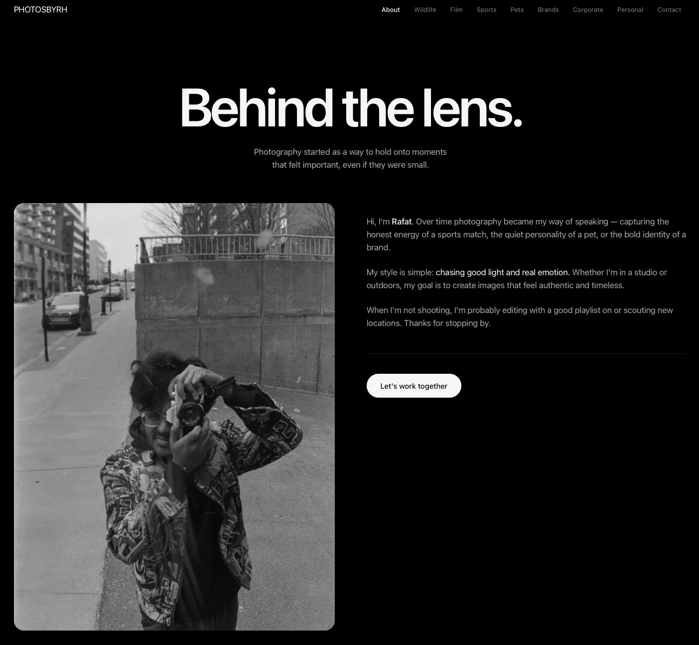
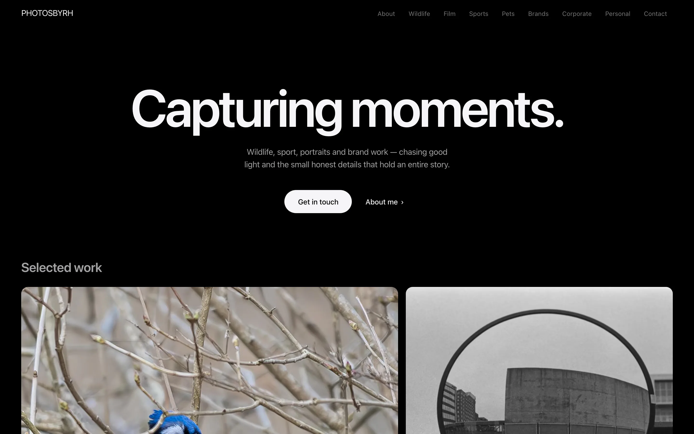

# PhotosByRH

Photography portfolio: wildlife, sports, pets, film, brands, and event work.




**Live:** [photo.rafathossain.com](https://photo.rafathossain.com)



Next.js 16, React 19, Tailwind v4, Framer Motion. Page and grid motion is CSS so it runs on the compositor; Framer Motion is only in the lightbox.

## Design

Type is the system font, tracking set per size, Anton for the wordmark. Tokens live in `app/globals.css`.

The palette is monochrome, so UI colour never competes with the photographs. The primary action is a white pill with a black label at 19.3:1, and every text colour clears WCAG AA.

Motion stays off the critical path: hero entrances are CSS, above-the-fold images are never hidden behind a reveal, and the lightbox mounts only the clicked photo.

## Development

```bash
npm install
npm run dev
```

Set `NEXT_PUBLIC_SITE_URL` if serving from another domain; `app/site.ts` uses it for the sitemap and Open Graph URLs.

## Images

Photos live in `public/`, one folder per gallery, imported statically so Next generates blur placeholders. After adding photos, run `node scripts/optimize-images.mjs` (add `--dry-run` to preview); it resizes to 2560px.

Any `quality` passed to `next/image` must also be listed in `images.qualities` in `next.config.ts`. Next 16 answers an unlisted quality with a 400 and the image silently never arrives.
